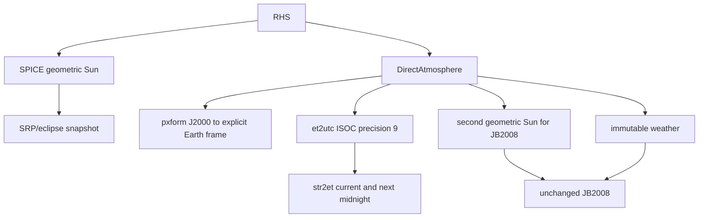
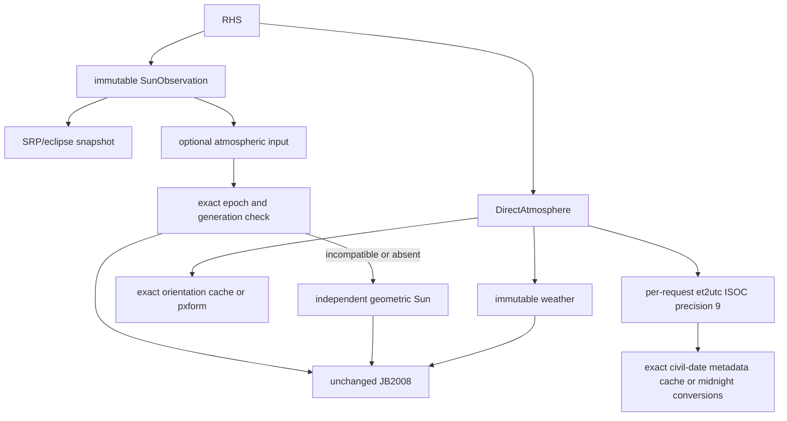

# ATM-OPT-001 design

## Boundary

Only environmental preprocessing is reused. Each atmospheric evaluation still performs coordinate conversion, weather selection and a fresh unchanged native density/temperature calculation. No density cache, ET bucket, interpolation, solver change or force-law change exists.

`DirectAtmosphere` borrows immutable weather and an ephemeris provider; those objects must outlive it. `EvaluationOptions` is copied at construction and has independent UTC, Sun-sharing and orientation switches. Two-argument `evaluate(epoch, position)` remains standalone. The optional third argument is a borrowed `const SunObservation*` valid for that call only. No supplied observation is retained in provider-wide or trajectory-global last-value storage.

## Before

## After

SRP is not a data provider. JB2008 never invokes SRP, inspects SRP configuration or requires an SRP object. The application acquires a Sun observation for any reason (SRP, eclipse, another diagnostic, or JB2008 alone) and can explicitly pass it to JB2008. NRLMSISE-00 and exponential ignore the optional input. The experiment acquires its observation where it previously acquired its geometric Sun state.

## Sun identity and provenance

Only `SpiceEphemerisProvider::observe_sun` can construct `SunObservation`. Its epoch, SI ephemeris state and configuration generation are const members. Public default construction and assignment are unavailable. Thus a caller cannot supply an unlabelled vector, change units or fabricate another target/frame/aberration correction through the supported API. Geometry is fixed to Sun NAIF 10 relative to Earth NAIF 399, J2000, geometric NONE, metres and metres/second.

The actual `spkez_c` acquisition and generation stamp occur under the same process-wide SPICE mutex. Compatibility requires identical IEEE-754 ET bits and the current managed kernel generation. The process-wide provenance deliberately permits observations from another provider when both use the same current process-global SPICE configuration. Provider instances are not isolated kernel contexts. A stale or wrong-epoch observation falls back to the original independent acquisition; incompatible geometry is unrepresentable. Signed-zero epochs are distinct; `nextafter` epochs never alias. No observation cache is introduced.

## UTC metadata

`utc_calendar` always converts the requested ET with the original `et2utc_c("ISOC",9)` and the original parsing/error rules. Calendar parsing, civil-date arithmetic, formatting and final seconds-of-day/quasi-MJD arithmetic run outside the SPICE lock. Each re-entry checks the sampled generation; a mutation during unlocked parsing/formatting restarts the request instead of mixing time-conversion configurations.

The key is the exact civil serial date plus the managed configuration generation, not ET/86400. A process-owned fixed array stores 32 dates with FIFO replacement. Values include both midnight ETs, the original rounded difference, serial date and day-of-year. The day length remains restricted to 86399..86401 exactly as before. Seconds-of-day and `40587 + serial + sod/day_length` are recomputed for every request in the original operation order. Positive leap seconds retain seconds-of-day 86400 and a day length of 86401.

The cache does not assume monotonic requests. Hits do not update replacement order. Concurrent readers may redundantly perform a miss conversion after unlocked formatting; insertion checks for an already-present date to avoid duplicate entries. This is safe and avoids extending locks over non-SPICE work.

## Orientation

`earth_fixed_rotation` keeps the explicit `ITRF93`/`IAU_EARTH` validation and error behavior. Its direction is always J2000 to the requested Earth frame; no reverse-transform API exists. That fixed direction is part of the cache's type/API identity. Reverse matrices are never inserted.

A process-owned 256-entry cache comprises 64 sets and four FIFO ways. Keys contain exact ET bits, frame identity and generation. A splitmix-style avalanche distributes high and low ET bits; set collisions do not equate keys. Each lookup checks at most four entries. Misses invoke the original `pxform_c` and copy the same nine doubles into an Eigen matrix. Failed requests are not cached. Disabled requests skip key hashing and do not populate entries. Memory is fixed and no allocation occurs on hits or misses.

## Synchronisation and lifecycle

### Two UTC execution paths

`utc_calendar(epoch, reuse)` has two distinct paths, sharing one conversion helper:

**Direct path (`reuse=false`).** One `SpiceLock` acquisition wraps the entire conversion: SPICE error mode, `et2utc_c`, parsing, both midnight `str2et_c` calls, day-length validation and quasi-MJD. This is a transcription of the original `6a1ad59` function, not an approximation of it. No generation is sampled, no lock is dropped, no cache is searched and no cache entry is written. This path is what diagnostic and A/B comparisons use to isolate the unchanged cost, so it must not carry reuse bookkeeping overhead.

**Reused path (`reuse=true`).** The generation-rechecked, two-phase path described above: SPICE conversion under lock, parsing unlocked, generation recheck, cache search, and a second locked phase for a miss.

Both call `convert_calendar_locked`, which performs every CSPICE call in the original order and holds the original error and leap-second validation. There is exactly one definition of the fragile time-conversion logic, so the two paths cannot drift in meaning, in error behaviour or in leap-second handling. `finish_calendar` likewise computes seconds-of-day and quasi-MJD once, in the original operation order.

The original `6a1ad59` behaviour is therefore preserved *exactly* in the disabled path and *provably identically* in the reused path, which is why the whole optimisation can be switched off without a measurable penalty.

### Locking

The existing CSPICE mutex protects all library CSPICE calls, cache accesses, generation changes and diagnostic counters. Orientation hits use that same mutex; no obsolete-generation hit can linearize after a managed mutation. UTC generation rechecking covers its unlocked non-SPICE interval. Const observations can be shared across concurrently evaluated trajectories; no mutable observation is shared.

Every actual library `furnsh_c` or `unload_c` attempt invalidates both caches and advances the generation **before** mutation. Partial metakernel load failure and cleanup unload also invalidate. Adding/removing a refcount owner without a kernel mutation does not invalidate. Cache entries are cleared, FIFO indices reset, and old observations become incompatible. Generation wrap terminates rather than reviving old provenance. Cache storage is process-owned for the library lifetime, not provider-owned; the final kernel owner unloading invalidates entries before they can be reused.

Supported lifecycle: arbitrary external CSPICE calls/mutations must not overlap library readers or lifecycle operations. Quiescent external reconfiguration must be followed by `invalidate_reuse()` before library calls resume. Unreported external kernel-pool/time-default mutation cannot be detected and is unsupported. Cache correctness does not imply external SPICE synchronisation.

Individual operations are linearizable, not an entire atmospheric evaluation or trajectory. A propagation requiring one scientifically coherent configuration must keep that configuration fixed across its run, as the original process-global provider already required. Managed lifecycle operations can overlap readers safely at the operation level; the tests exercise this without replacing the trajectory's scientific configuration.

## Diagnostics and controls

Normal production builds contain no diagnostic timers, logging or hit/miss counter increments. `LEO_SPICE_REUSE_DIAGNOSTICS` compiles counters and mutex wait timing into a separate benchmark library and process; it is never linked into the measured production binary. `reuse_statistics()` reports fixed memory/occupancy in either build; counters are zero without diagnostics. Counter reset leaves caches and provenance unchanged. `invalidate_reuse()` changes provenance and clears caches, not just counters.

The unchanged original has a separate diagnostic executable using GNU linker interposition for actual CSPICE call counts and its identified SPICE mutex. Its scientific libraries/source remain unchanged; try-lock/timer/counter overhead is confined to that executable. Baseline diagnostic counters are reported from that process, not as zero placeholders from uninstrumented timings.

Shared-versus-thread-local policy replay is benchmark-only. It uses exact recorded keys and the actual hash/replacement policy, compares the same total capacity, and is interpreted with measured shared-cache contention. Replay is not proof of alternative real parallel throughput; no claim that a shared cache universally wins is made.
